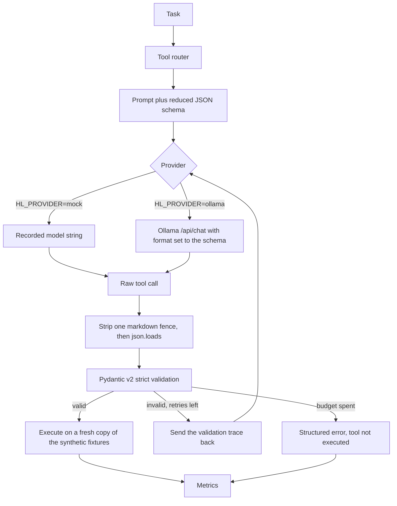
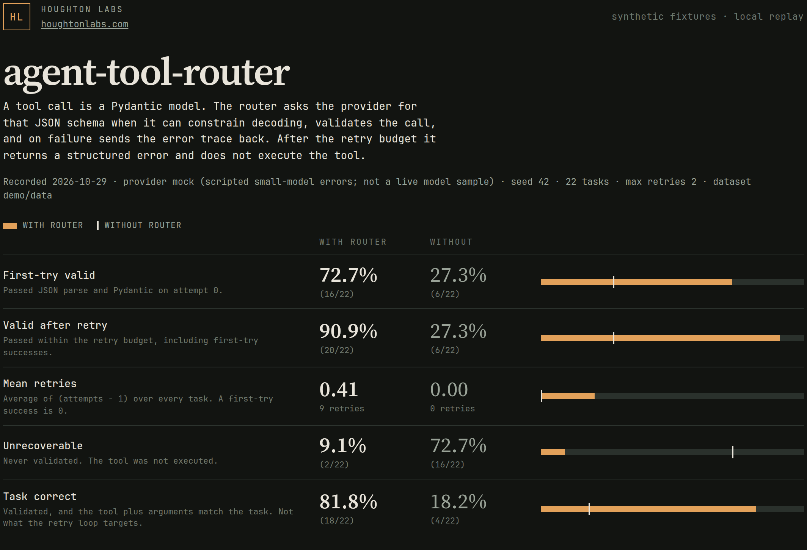
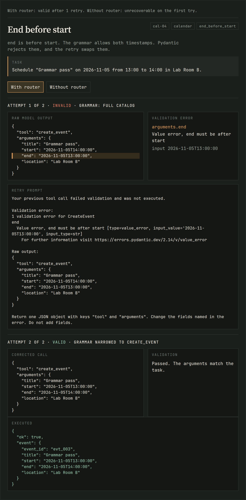
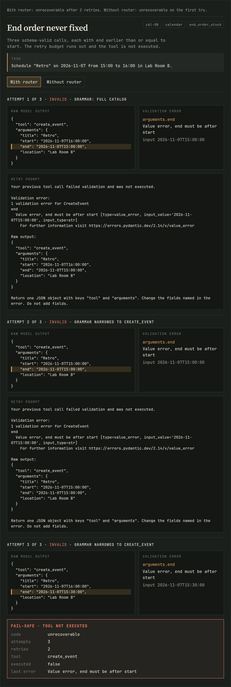
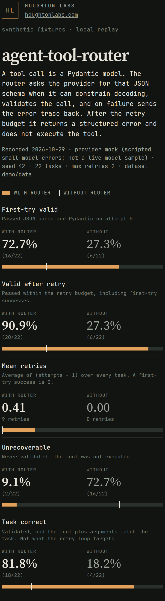

# agent-tool-router

A strict tool router for small language models: declare each tool as a Pydantic v2 model, force the call into a JSON schema when the provider can constrain decoding, and on failure retry with the validation error instead of executing a bad call.

## Why it matters

Small local models often pick a tool and then miss the contract. `minutes` comes back as `"90"`, a status comes back as `"In Progress"`, an event ends before it starts, or the JSON has a trailing comma. A caller that does one `json.loads` and hopes will either drop the task or run the wrong thing. The router makes the Pydantic model the contract. Grammar-constrained decoding fixes the errors a grammar can express. The retry loop feeds back the errors it cannot, including patterns and cross-field checks. After N failures the router returns a structured error and does not call the tool.

## How it works



The baseline arm is the same code with the schema and the retry loop turned off: one sample, fence strip, parse, validate, stop.

## Quick start

```bash
make install        # pydantic 2.14.1 + pytest
make test           # unit tests, no model and no API key
make bench          # mock provider, write results/runs/mock-seed42.json
make record         # bench, and publish site/data for the replay
make run            # http://127.0.0.1:8787  replay plus POST /api/run
```

`HL_DATASET_URI` overrides the dataset directory (a local path or a `file://` URI). The default is `demo/data`.

| Variable | Effect |
|---|---|
| `HL_DATASET_URI` | Dataset directory. Default `demo/data`. |
| `HL_PROVIDER` | `mock` (default) or `ollama`. |
| `OLLAMA_HOST` | Default `http://127.0.0.1:11434`. |
| `OLLAMA_MODEL` | Required when `HL_PROVIDER=ollama`. |
| `HL_MAX_RETRIES` | Retry budget for the router arm. Default `2`. |
| `HL_SEED` | Recorded on every run. Ollama uses it with temperature 0. Default `42`. |
| `HL_PORT` | Local server port. Default `8787`. |

`make record` publishes `site/data` only for the mock provider. An Ollama run writes `results/runs/` and leaves the replay alone unless you pass `--publish`.

## Method

- **Tools are Pydantic models.** Calendar (`create_event`, `list_events`, `cancel_event`), tracker (`log_time`, `set_status`), and lookup (`lookup_contact`, `lookup_doc`). `strict=True` and `extra='forbid'`. The string `"90"` is not an integer. An unknown field is rejected.
- **The grammar gets a reduced schema.** Ollama's `format` field is backed by a grammar that reliably expresses types, enums, required keys, length, and numeric bounds. The router sends an `anyOf` of per-tool objects with those constraints. It drops regex patterns and cross-field checks. Those stay on the Pydantic model, where the error message names the field.
- **Retry narrows the schema.** If the tool name parsed, the next attempt is constrained to that tool's arguments. The user message contains the raw output and `str(ValidationError)`.
- **Fail safe.** An invalid call is not executed. The result is `{ok: false, code: "unrecoverable" | "provider_error", ...}`. Each task gets its own copy of the fixtures, so a failed task cannot leak into the next one.
- **Same parser on both arms.** Fence stripping is shared preprocessing. It is not a retry. Trailing commas, wrong types, and extra fields still fail the baseline.
- **Mock provider.** `HL_PROVIDER=mock` replays strings in `demo/data/recordings.json`. If the router passed a schema and the prompt has no validation error yet, the replay returns `constrained`. Each validation-error prompt advances to the next `retry` string. Tests and CI need no keys and no Ollama.
- **Fixed task set.** 22 synthetic tasks. The user message already names the id or the day. The router does not do retrieval, and it does not judge whether a schema-valid call is the right call.

Metrics, over every task:

| Metric | Definition |
|---|---|
| First-try valid | Attempt 0 parsed and passed Pydantic. |
| Valid after retry | Some attempt inside the budget passed, including first-try successes. |
| Mean retries | Average of (attempts − 1). A first-try success contributes 0. An unrecoverable task that used both retries contributes 2. |
| Unrecoverable | No attempt validated. The tool was not executed. |
| Task correct | Validated, and the tool plus arguments match the task. The retry loop does not target this. A schema-valid wrong day counts as valid and incorrect. |

Pydantic is pinned to 2.14.1 so the recorded validation traces stay byte-stable.

## Results

Recorded **2026-10-29** from `results/runs/mock-seed42.json`. Provider: **mock (scripted small-model errors; not a live model sample)**. Seed 42. 22 tasks. Max retries 2. Dataset `demo/data`. This is not an Ollama measurement. Run `HL_PROVIDER=ollama OLLAMA_MODEL=... make bench` to write a separate, labeled file. Do not mix the two.

| arm | first-try valid | valid after retry | mean retries | unrecoverable | task correct |
|---|---|---|---|---|---|
| with router | 72.7% (16/22) | 90.9% (20/22) | 0.41 | 9.1% (2/22) | 81.8% (18/22) |
| without router | 27.3% (6/22) | 27.3% (6/22) | 0.00 | 72.7% (16/22) | 18.2% (4/22) |

The grammar does the first jump: trailing commas, string integers, floats, enums, empty strings, extra fields, and unknown tool names are gone on attempt 0 when a schema was sent. The retry loop picks up what the reduced schema does not encode. Two tasks stay unrecoverable: an event id that never matches `evt_###`, and an end time that stays before the start. Two more validate and still miss the task (wrong day, shortened name). The router does not retry those, because the call was legal.



`cal-04` is a cross-field failure. The grammar accepts both timestamps. Pydantic rejects `end`, the retry prompt quotes that error, and the next call swaps the times. The baseline stops on the first invalid call.



`cal-08` uses the whole budget. Three schema-valid calls each have `end` earlier than or equal to `start`. The fail-safe result names the code, the attempt count, and the last error. The calendar is unchanged.





The static site reads `site/data/scoreboard.json` and `site/data/traces.json`. Open it with `make run`. On that server, each task has **Re-run this arm locally**, which posts to `/api/run` and checks the live result against the recording. Cloudflare Pages serves the files only, so the button is absent there.

## Design decisions and tradeoffs

- **Pydantic is the source of truth, not the grammar.** A grammar that cannot say "end after start" or "id matches `evt_###`" should not be the last check. The cost is an extra round trip for those errors.
- **Reduced schema, not the raw Pydantic schema.** Patterns and `format` are uneven in llama.cpp's GBNF conversion. Sending them would imply a constraint the sampler may ignore. The prompt still states the pattern in words. The mock shows the model violating that sentence until Pydantic rejects it.
- **`anyOf` of per-tool objects, then a narrowed schema on retry.** A single loose envelope (`arguments: object`) would not constrain types. A full discriminated union is what we send on attempt 0. Narrowing on retry keeps the second grammar smaller once the tool name is known.
- **Strict mode, no coercion.** `"90"` and `1.5` fail on purpose. A lenient parser would hide the bug the router is there to show.
- **ISO-8601 timestamps are strings, not `datetime`.** The pattern is `YYYY-MM-DDTHH:MM:SS` with no offset. Zero-padded strings in that shape sort lexicographically, so "end after start" does not depend on timezone parsing. Offsets are rejected rather than interpreted.
- **Baseline is the router with two switches off,** not a second parser. The comparison is schema constraint plus retry.
- **The mock replays by attempt. It does not run a grammar.** When the router passes a schema, the recording returns the string we stored as the constrained output. That is the right shape for a demo and the wrong thing to quote as a model score. The Ollama provider really does set `format` to the schema and omits `format` on the baseline.
- **One tool call per task.** Multi-step agents are a different measurement. This repo is the validation layer.
- **Default N is 2.** More retries spend context and tend to repeat the same mistake, which `cal-05` and `cal-08` already show.

## Caveats

- The table above is the mock provider on 2026-10-29, seed 42, 22 tasks. It is a fixed script of failure classes (syntax, types, enums, bounds, patterns, cross-field checks, and schema-valid wrong arguments). It is not a sample of Llama 3.2 or any other model.
- No Ollama numbers are checked in. A live run belongs in `results/runs/` under an `ollama:<model>` name, and it should not replace this table unless you re-record and label it.
- The task set is small and synthetic. Names, rooms, and tickets are fictional. There is no personal data in `demo/data/`.
- Schema-valid wrong arguments are counted as valid. Task correct is the column that shows them. The router will book the wrong day if the timestamps parse.
- Fence stripping is shared. A fenced but otherwise valid call passes the baseline (`cal-02`). That is deliberate.
- `anyOf` support varies by runtime. If a backend rejects the catalog schema, the Ollama provider surfaces the error as `provider_error` and does not execute. It does not silently drop the schema.
- Mean retries includes tasks that never validate. It is not "retries among the ones that recovered."

## Layout

```
toolrouter/          schema reduction, tools, router, mock and Ollama providers, metrics, server
demo/data/           tasks.json, recordings.json, fixtures.json
site/                static replay (index.html, assets, data/*.json)
docs/images/         screenshots from scripts/screenshots.py (headless Chromium)
results/runs/        recorded benchmark JSON
tests/               pytest, no network
scripts/screenshots.py
```

Screenshots: `python3 -m pip install playwright` and `python3 scripts/screenshots.py`, with Chrome at `/usr/local/bin/google-chrome`. CI does not run that script. The checked-in PNG files are the run from 2026-10-29.

## License

MIT, see [LICENSE](LICENSE).

Fonts in `site/assets/fonts/` are Source Serif 4 (Adobe) and JetBrains Mono, both under the SIL Open Font License. See the `OFL-*.txt` files next to them.

## Cloudflare Pages (portfolio demo)

Live demo: not deployed yet.

Static site root: `site/`. Replay JSON: `site/data/scoreboard.json` and `site/data/traces.json`, generated from the mock run by `make record`.

Suggested Pages project: **agent-tool-router** · Production branch `main` · Framework none · Build command empty · Output directory `site`. `wrangler.toml` sets `pages_build_output_dir = "site"`.
